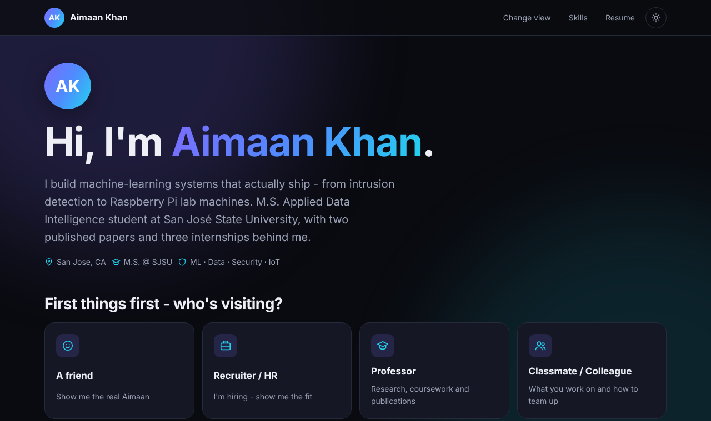

# Aimaan Khan - Portfolio

A multi-page portfolio that adapts to whoever is visiting. The landing page asks who you are, then shows a version written for you.

**Live site:** https://aimk937.github.io/Portfolio/




---

## How it works

| Visitor picks | Page | Tone |
| --- | --- | --- |
| A friend | `friend.html` | Informal and a bit funny |
| Recruiter / HR | `hire.html` → `role.html?r=...` | Picks a role, then sees only what fits it |
| Professor | `academic.html?for=professor` | Formal - publications and research first |
| Classmate / Colleague | `academic.html?for=colleague` | Friendly-professional - how to team up |
| Brand / Community | `role.html?r=ambassador` | Ambassador and creator side |
| Just curious | `academic.html?for=visitor` | Quick tour |

**Recruiter roles:** Software Developer, Data Scientist, Data Analyst, Machine Learning Engineer, Cybersecurity Analyst, IoT / Embedded Engineer, Student / Brand Ambassador, On-campus Student Assistant.

Every page links to `skills.html`, which groups all skills by role, plus creative and people skills.

Also included: dark / light mode, a remembered visitor choice, certificate viewer, mobile layout, link-preview image, and a 404 page.

---

## Editing content

Full step-by-step guide with copy-paste templates: **[EDITING.md](EDITING.md)**.

**All text lives in `assets/js/data.js`.** You never need to touch the HTML or other JS.

| To change | Edit in `data.js` |
| --- | --- |
| Name, intro, email, links | `person` |
| Landing-page options | `visitors` |
| Jobs | `experience` |
| Projects (and which role pages show them) | `projects` - the `roles` list on each project |
| A recruiter role page | `roles` |
| Skills page | `skillClusters` |
| Friend page jokes and stats | `friend` |

To add a project to the ML page, for example, add `"ml"` to that project's `roles` list.

**Profile photo:** save a square photo as `assets/img/profile.jpg`. It replaces the "AK" initials everywhere automatically.

**Resume:** replace `assets/docs/Resume_Aimaan_Khan.pdf` (keep the same file name).

**Colors and fonts:** the tokens at the top of `assets/css/style.css`.

---

## Structure

```
index.html          landing page + "who's visiting?"
friend.html         informal page
academic.html       professor / colleague / quick-tour page
hire.html           recruiter role picker
role.html           role-specific page (?r=software, ml, ...)
skills.html         all skills grouped by role
404.html
assets/
  css/style.css     all styling
  js/data.js        all content
  js/app.js         renders every page from data.js
  img/              favicon, preview, certificates (WebP)
  docs/             resume PDF
```

## Run locally

```bash
python3 -m http.server 8000
# open http://localhost:8000
```

Or just double-click `index.html` - it works without a server too.

## Deploy

GitHub Pages: **Settings > Pages > Deploy from branch > `main` / root**.
